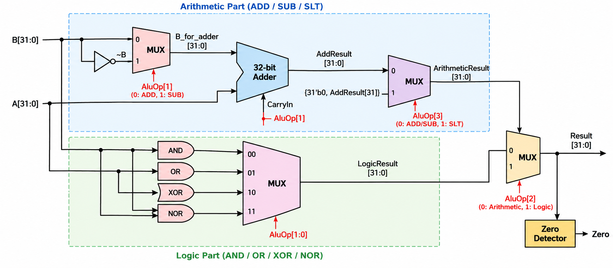

# Lab 05 - 32-Bit Arithmetic Logic Unit

Lab 05 implements a combinational 32-bit arithmetic logic unit (ALU). Two 32-bit operands and a four-bit operation code select an arithmetic, comparison, or bitwise operation; the design also reports whether the result is zero.

## Design

| File | Role |
| --- | --- |
| [src/alu.v](src/alu.v) | Implements the arithmetic path, logic path, result multiplexer, and zero detector. |
| [src/timing.xdc](src/timing.xdc) | Applies a 20 ns maximum input-to-output delay constraint. |
| [reports/](reports/) | Contains Vivado I/O, placed-utilization, and routed-timing reports. |

The module interface is:

| Port | Width | Direction | Meaning |
| --- | ---: | --- | --- |
| `A` | 32 | Input | First operand. |
| `B` | 32 | Input | Second operand. |
| `AluOp` | 4 | Input | Selects the ALU operation. |
| `Result` | 32 | Output | Selected arithmetic or logic result. |
| `Zero` | 1 | Output | High when every bit of `Result` is zero. |

## Operations

The following canonical `AluOp` values select the seven implemented operations:

| `AluOp` | Operation | Result |
| --- | --- | --- |
| `0000` | ADD | `A + B` |
| `0010` | SUB | `A - B` |
| `1010` | SLT | The sign bit of `A - B`, zero-extended to 32 bits. |
| `0100` | AND | `A & B` |
| `0101` | OR | `A \| B` |
| `0110` | XOR | `A ^ B` |
| `0111` | NOR | `~(A \| B)` |

`AluOp[2]` chooses between the arithmetic and logic paths. The arithmetic path reuses one 32-bit adder: `AluOp[1]` optionally inverts `B` and also supplies the carry-in, implementing two's-complement subtraction without a separate subtractor. For the SLT operation, `AluOp[3]` selects the zero-extended most significant bit of the subtraction result. The logic path uses `AluOp[1:0]` to choose AND, OR, XOR, or NOR.

## Block diagram

The diagram shows the shared adder, the four parallel bitwise operations, the arithmetic/logic result selection, and the final zero detector.

## Vivado implementation results

The supplied reports were generated with Vivado 2026.1 for the Xilinx Artix-7 `xc7a35tcpg236-1` device.

| Metric | Result |
| --- | ---: |
| Slice LUTs | 107 / 20,800 (0.51%) |
| Occupied slices | 30 / 8,150 (0.37%) |
| Slice registers | 0 |
| Block RAM tiles | 0 |
| DSP blocks | 0 |
| User I/O | 101 / 106 (95.28%) |

The 101 user I/O signals correspond exactly to 68 input bits (`A`, `B`, and `AluOp`) plus 33 output bits (`Result` and `Zero`). Because the ALU is entirely combinational, it uses no registers.

The routed timing report confirms that the 20 ns maximum-delay constraint is met:

| Timing metric | Result |
| --- | ---: |
| Worst negative slack (WNS) | 2.043 ns |
| Total negative slack (TNS) | 0.000 ns |
| Failing endpoints | 0 |
| Worst data-path delay | 17.957 ns |
| Worst path | `AluOp[1]` to `Zero` |

## Part 3 report answers

The values requested in Part 3 can be read directly from the supplied placed-utilization, I/O, and routed-timing reports:

| Question | Answer | Report source |
| --- | --- | --- |
| Number of LUTs | **107 Slice LUTs** | `alu_utilization_placed.rpt` |
| Number of bonded IOBs | **101** | `alu_utilization_placed.rpt` |
| FPGA pin connected to output `Zero` | **Package pin `J1`**; FPGA pin name `IO_L3N_T0_DQS_AD5N_35` | `alu_io_placed.rpt` |
| Where the longest path starts | **`AluOp[1]`**, an input port (package pin `K3`) | `alu_timing_summary_routed.rpt` |
| Where the longest path ends | **`Zero`**, an output port (package pin `J1`) | `alu_timing_summary_routed.rpt` |
| Delay of the longest path | **17.957 ns** | `alu_timing_summary_routed.rpt` |
| Routing portion of the longest path | **68.004%** (12.211 ns of 17.957 ns) | `alu_timing_summary_routed.rpt` |
| Logic levels in the longest path | **14** | `alu_timing_summary_routed.rpt` |

The 14 logic levels consist of eight `CARRY4` stages, one input buffer, one `LUT3`, one `LUT5`, two `LUT6` stages, and one output buffer. With a 20.000 ns requirement and a 17.957 ns data-path delay, the path has 2.043 ns of positive slack and therefore meets the constraint.

## Project use

Add `src/alu.v` and `src/timing.xdc` to a Vivado project and select `alu` as the top-level module. The files under `reports/` preserve the supplied post-placement and post-routing implementation results for reference.
